<a href="https://wstech.tech"><picture><source media="(max-width: 1011px) and (prefers-color-scheme: dark)" srcset="assets/profile-mobile-dark.svg"><source media="(max-width: 1011px)" srcset="assets/profile-mobile-light.svg"><source media="(prefers-color-scheme: dark)" srcset="assets/profile-dark.svg"></picture></a> 
<a href="https://wstech.tech"><picture><source media="(max-width: 1011px) and (prefers-color-scheme: dark)" srcset="assets/link-website-mobile-dark.svg"><source media="(max-width: 1011px)" srcset="assets/link-website-mobile-light.svg"><source media="(prefers-color-scheme: dark)" srcset="assets/link-website-dark.svg"></picture></a><a href="https://blog.wstech.tech"><picture><source media="(max-width: 1011px) and (prefers-color-scheme: dark)" srcset="assets/link-blog-mobile-dark.svg"><source media="(max-width: 1011px)" srcset="assets/link-blog-mobile-light.svg"><source media="(prefers-color-scheme: dark)" srcset="assets/link-blog-dark.svg"></picture></a><a href="https://www.linkedin.com/in/wilsonsousajr"><picture><source media="(max-width: 1011px) and (prefers-color-scheme: dark)" srcset="assets/link-linkedin-mobile-dark.svg"><source media="(max-width: 1011px)" srcset="assets/link-linkedin-mobile-light.svg"><source media="(prefers-color-scheme: dark)" srcset="assets/link-linkedin-dark.svg"></picture></a> 
<a href="https://github.com/WilsonSousajr"><picture><source media="(max-width: 1011px) and (prefers-color-scheme: dark)" srcset="assets/stats-mobile-dark.svg"><source media="(max-width: 1011px)" srcset="assets/stats-mobile-light.svg"><source media="(prefers-color-scheme: dark)" srcset="assets/stats-dark.svg"></picture></a>

<a href="mailto:wstechnology.br@gmail.com">wstechnology.br@gmail.com</a>

